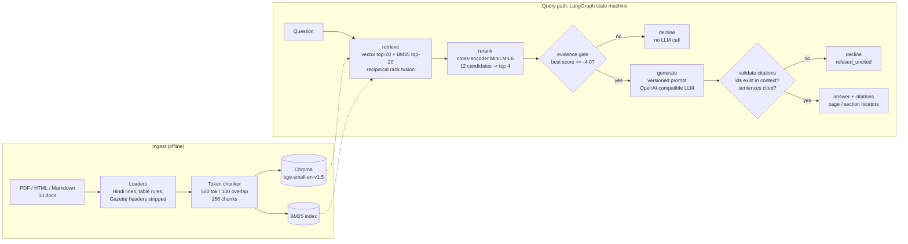
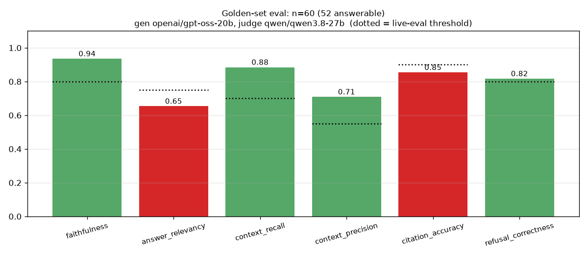
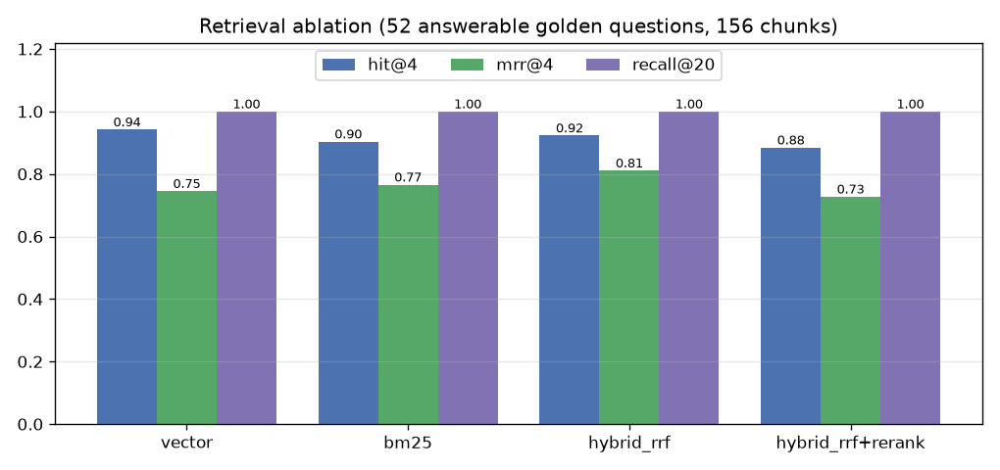
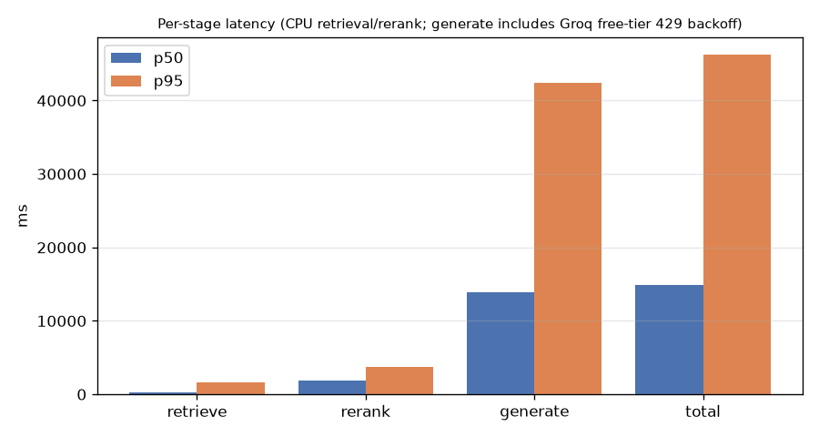

# DroneDocs RAG: a cited question-answering system for drone rules and autopilot docs

<!-- links -->
[](https://github.com/burlarakesh1458-sys/dronedocs-production-rag/actions/workflows/ci.yml) **Live demo:** <http://rakeshburla.dpdns.org/dronedocs-production-rag/> · **Code:** <https://github.com/burlarakesh1458-sys/dronedocs-production-rag> · **Resume bullets:** [RESUME_BULLETS.md](RESUME_BULLETS.md) · **License:** MIT

DroneDocs answers questions about **Indian drone regulations** (Drone Rules 2021 and the 2022/2023
amendments) and the **ArduPilot / PX4 autopilot documentation**. Every answer cites the exact chunk,
PDF page or doc section it came from. When the retrieved evidence does not support an answer, the
system **declines** instead of guessing.

I built it to see what separates a RAG demo from a RAG system you could actually ship: hybrid retrieval,
a cross-encoder reranker, enforced citations, prompts kept in versioned files, a hand-verified golden set,
and a CI quality gate that fails the build when answer quality drops.

> All numbers below were measured in this repo. Raw reports: `reports/latest.json` (eval) and
> `reports/retrieval_ablation.json` (retrieval). Charts: `docs/`.

## The problem

Drone pilots in India have to work across a 2021 gazette notification (bilingual Hindi/English PDFs),
two amendments, a PIB explainer, and the ArduPilot and PX4 docs for the autopilot they actually fly.
The questions are exact ("What is the default `RTL_ALT_M`?", "What fee is charged for a remote pilot
certificate?"), and a plausible but wrong answer is worse than none. So the system has to:

1. find the right paragraph, even when the user types an exact parameter name (`FS_THR_ENABLE`),
2. answer only from that paragraph and say where it came from, and
3. decline when the corpus doesn't hold the answer ("What is the max speed of a DJI Mini 4 Pro?").

## Architecture



Every graph node reports to optional observers (`on_stage`), so tracing can be added without this
package depending on a tracing vendor. The observability layer in the sibling repo
([`rag-observability-gating`](https://github.com/burlarakesh1458-sys/rag-observability-gating)) is built on exactly that hook.

## Features

| Area | What's implemented |
|---|---|
| Ingestion | PDF (pypdf, page-level locators), ArduPilot HTML (section breadcrumbs), PX4 Markdown (heading breadcrumbs). Hindi lines, markdown table rules and repeated Gazette headers are dropped before chunking. |
| Chunking | `cl100k_base` token windows, 550 tokens with 100 overlap (the 500-800 band), 40-token minimum, content hash per chunk. |
| Retrieval | Hybrid: Chroma (cosine, `BAAI/bge-small-en-v1.5` with query instruction) + BM25 (custom tokenizer that keeps `RTL_ALT_M`, `10.5`), merged with Reciprocal Rank Fusion (k=60). |
| Reranking | `cross-encoder/ms-marco-MiniLM-L-6-v2` over the 12 best fused candidates (256 tokens per pair), top 4 go in the prompt. Cohere `rerank-english-v3.0` is a config switch. |
| Citation enforcement | Evidence gate declines before the LLM is called; validator rejects invented chunk ids and answers with too many uncited sentences; invalid ids are stripped. |
| Prompts as config | `configs/prompts/answer_v1.yaml` (`answer-v1.2`) and `judge_v1.yaml` (`judge-v1.1`) carry a version string that is written into every result and report. |
| Serving | FastAPI (`/ask`, `/ingest`, `/health`, built-in HTML UI at `/`), CLI (`dronedocs ask`), Streamlit UI, Dockerfile + compose. |
| LLM client | Any OpenAI-compatible endpoint (Groq by default, OpenAI, vLLM, Ollama). Backs off on 429/5xx and honours `retry-after`, paces itself from the `x-ratelimit-*` headers, keeps an optional sqlite response cache, stops fast when the daily quota is gone, records token usage. `ReplayClient` serves recorded answers for the offline gate. |
| Evaluation | 60-item golden set (52 answerable, 8 unanswerable) with quoted evidence checked by `scripts/verify_golden.py`. Metrics: faithfulness and answer relevancy (LLM judge, a different model family from the generator), context precision/recall, citation accuracy/validity, refusal correctness, MRR, per-stage p50/p95 latency. Optional Ragas cross-check. |
| CI | GitHub Actions on every push/PR: ruff (lint + format), golden-set verification, offline unit tests, the offline replay gate over all 60 golden items (no API key) and a Docker build. The live golden eval against Groq runs on manual dispatch. |

## Quickstart

```bash
python -m venv .venv && source .venv/bin/activate
make install-dev                      # CPU torch + deps
cp .env.example .env                  # set LLM_API_KEY (Groq key works as-is)
make ingest                           # build Chroma + BM25 index from data/raw (~4 min on 2 CPUs)
make ask Q="What is the maximum all-up weight of a nano drone?"
make serve                            # http://localhost:8000  (HTML UI + /docs)
make test                             # offline unit tests, no network / no model downloads
make eval                             # full golden eval, exits 1 below thresholds
```

Example (real output from this repo):

```
$ dronedocs ask "What is the maximum all-up weight of a nano unmanned aircraft system under the Drone Rules 2021?"
The maximum all-up weight of a nano unmanned aircraft system is **250 grams or less**[drone_rules_2021.pdf#c005].
  [drone_rules_2021.pdf#c005] drone_rules_2021.pdf - pages 27-28
```

Fully offline: point `LLM_BASE_URL` at Ollama (`http://localhost:11434/v1`) and set
`DRONEDOCS__LLM__MODEL` / `DRONEDOCS__JUDGE__MODEL`.

## Configuration

Everything lives in `configs/settings.yaml`, and any key can be overridden with an env var
`DRONEDOCS__<SECTION>__<KEY>`:

| Key | Value | Why |
|---|---|---|
| `llm.model` | `openai/gpt-oss-20b` | generator (Groq), `reasoning_effort: low` |
| `judge.model` | `qwen/qwen3.8-27b` | judge from a different model family, separate rate-limit bucket |
| `chunking.chunk_tokens / overlap_tokens` | 550 / 100 | |
| `retrieval.vector_k / bm25_k / rrf_k` | 20 / 20 / 60 | |
| `rerank.candidates / max_length / top_n` | 12 / 256 / 4 | CPU cost scales with candidates x length |
| `guardrails.min_rerank_score` | -4.0 | evidence gate |
| `eval.thresholds` | faithfulness 0.80, answer_relevancy 0.75, context_recall 0.70, context_precision 0.55, citation_accuracy 0.90, refusal_correctness 0.80 | live quality bar (`dronedocs eval`) |
| `eval.offline_thresholds` | see the offline gate table below | CI gate (`dronedocs eval --offline`) |

## Results

### Golden-set evaluation (`reports/latest.json`, live)

Generator `openai/gpt-oss-20b`, judge `qwen/qwen3.8-27b`, prompt `answer-v1.2`, judge prompt `judge-v1.1`.
**All 60 items scored** (52 answerable + 8 unanswerable). The run was resumed across two days of Groq
free-tier quota: 38 items on the first day, the remaining 22 the next morning (`dronedocs eval --resume`,
checkpointed per item, client-side pacing from the rate-limit headers).



| Metric | Value | Live threshold | |
|---|---|---|---|
| Faithfulness (claims supported by cited chunks, LLM judge) | **0.935** | 0.80 | pass |
| Answer relevancy (vs. reference answer, LLM judge; false declines count as 0) | 0.654 | 0.75 | **fail** |
| Context recall (gold evidence in the 4 prompt chunks) | 0.885 | 0.70 | pass |
| Context precision (average precision of the 4 prompt chunks) | 0.709 | 0.55 | pass |
| Citation accuracy (answer cites a gold-evidence chunk) | 0.854 (35/41) | 0.90 | **fail** |
| Citation validity (cited ids exist in the context) | **1.000** | | |
| Refusal correctness (answer vs. decline, all items) | 0.817 | 0.80 | pass |
| Answer rate on answerable questions | 0.788 (41/52) | | |
| Decline rate on unanswerable questions | **1.000** (8/8: 4 by the evidence gate with 0 LLM tokens, 4 by the model) | | |
| Fused candidate recall@20 | 1.000 | | |
| MRR of the gold chunk within the 4 prompt chunks | 0.728 | | |

**The live gate fails, and here is why.** I read every miss in `reports/latest.json`:
- *False declines are the biggest cost* (11 of 52 answerable): 6 by the model's own `INSUFFICIENT_EVIDENCE`
  sentinel, 4 rejected by the citation validator as uncited, 1 by the evidence gate. **6 of the 11 are PX4
  questions** (PX4 answered 7/13 vs. ArduPilot 9/11 and Drone Rules 20/23): the PX4 parameter pages are long
  tables, and the 4 prompt chunks often hold the parameter name without the sentence that answers the question.
  Each false decline scores 0 answer relevancy, which is most of the gap to 0.75 (on the 41 answered items
  relevancy is 0.83: 29 scored 1.0, 10 scored 0.5, 2 scored 0).
- *Citation accuracy* misses (6 of 41 answers): in 4 the judge found every claim supported but the cited chunk
  was not the verified gold location (dr-06, dr-12, dr-19, pib-02: the PIB backgrounder or a neighbouring
  gazette chunk instead of the rule text). The other 2 (dr-08, px-04) were unsupported answers.
- Faithfulness below 1.0 on 4 answers: dr-08 and px-04 (0.0), dr-20 and ap-06 (0.67).

Token use for the 60 items: 129,021 prompt + 4,952 completion tokens (generator, mean 2,346 prompt tokens per
call) and 42,883 judge tokens.

### Offline CI gate (`reports/offline_gate.json`, no API key)

The build cannot depend on a rate-limited free API: the first version of this CI ran the live eval on every
push, and a run on 2026-11-06 failed with `citation_accuracy 0.815 < 0.90` only because Groq returned HTTP 429
(daily quota) for most items. CI now runs `dronedocs eval --offline`: real ingestion, hybrid retrieval, rerank,
evidence gate and citation validation over all 60 golden items, with the generator replaced by the **55 answers
recorded from the live run** (`eval/recordings/`, frozen by `scripts/record_answers.py`; the other 5 items are
declined by the evidence gate before any LLM call). The judge metrics are not recomputed offline. It gates on
regression floors in `eval.offline_thresholds`, so a change to chunking, retrieval, reranking, the gate or the
citation validator that loses evidence or breaks citations fails the build deterministically.

<!-- OFFLINE_TABLE -->

The live eval is still one click away (`workflow_dispatch` with `live_eval`, or `make eval` locally) and keeps
the 0.90 / 0.75 bar above; it is not lowered to make the build green.

### Retrieval ablation (`reports/retrieval_ablation.json`, all 52 answerable items, no LLM)

Final config: k = 4 chunks in the prompt, 20+20 candidates fused, cross-encoder over 12 candidates x 256 tokens.



| Retriever | Hit@4 | MRR@4 | Recall@20 | p50 latency | p95 latency |
|---|---|---|---|---|---|
| Vector (bge-small) | **0.942** | 0.745 | 1.000 | 127 ms | 220 ms |
| BM25 | 0.904 | 0.766 | 1.000 | 0.5 ms | 1.8 ms |
| Hybrid (RRF) | 0.923 | **0.811** | 1.000 | 131 ms | 776 ms |
| Hybrid + cross-encoder rerank | 0.885 | 0.728 | 1.000 | 2,194 ms | 4,128 ms |

**Finding: the reranker does not pay for itself on this corpus.** Hybrid RRF gives the best ranking
(MRR 0.811, +0.065 over vector-only). The general-domain MS MARCO MiniLM cross-encoder *lowers* MRR to
0.728 and adds ~2 s on CPU. An earlier run with a heavier setting (20 candidates x 512 tokens, k=5,
on an earlier index build; `reports/retrieval_ablation_top5_ce20x512.json`) showed the same direction
(MRR 0.760 hybrid vs 0.745 reranked) at ~9.5 s per query. I kept the reranker in the serving path because
its score is the calibrated signal behind the evidence gate (`min_rerank_score`), which declined 4 of the 8
unanswerable questions without an LLM call (the model's sentinel declined the other 4). Replacing it with a domain-tuned reranker, or gating on
fused scores instead, is the top item in Future work.

### Ragas cross-check

`scripts/ragas_crosscheck.py` scored the first 3 answered items (dr-01..dr-03) with Ragas 0.4.3
(`qwen/qwen3.8-27b` as the Ragas LLM; `reports/ragas_crosscheck.json`):

| Items | Ragas faithfulness | Ragas context recall | Built-in judge faithfulness (same items) |
|---|---|---|---|
| 3 | 1.00 (3/3 scored) | 1.00 (3/3 scored) | 1.00 |

The two judges agree, but this is a sanity check on 3 easy items, not a validation. Ragas makes several
LLM calls per metric per item (~9k tokens/item), which the free tier can't afford across the full set,
so the single-call built-in judge stays the CI gate. An earlier attempt with `gpt-oss-20b` as the Ragas
LLM scored **0 of 3** items (every metric came back NaN), so the Ragas LLM is now configured separately
from the generator.

### Latency (golden-set run)



| Stage | p50 | p95 |
|---|---|---|
| retrieve (hybrid, CPU) | 258 ms | 1,566 ms |
| rerank (cross-encoder, CPU) | 1,856 ms | 3,680 ms |
| generate (Groq, incl. rate-limit backoff and pacing waits) | 13,929 ms | 42,463 ms |
| total | 14,872 ms | 46,266 ms |

26 of 55 generation calls hit at least one HTTP 429 (free tier: 8k tokens/minute), and the resumed part of the
run also waited client-side for the token window to refill; both waits are inside the generate numbers. Of the
29 calls with no 429 retry, 22 took under 3 s and the median was **1.0 s**, so on a paid tier the end-to-end
p50 would be roughly retrieval + rerank + ~1 s.

## Design decisions and trade-offs

- **Hybrid retrieval, measured, not assumed.** BM25 alone misses paraphrases and vector search alone
  ranks exact parameter names poorly. RRF fusion gave the best MRR in the ablation. Every retriever finds
  the evidence somewhere in its top 20, so the real difference is ordering.
- **The reranker stays for the gate, not for ranking.** The ablation shows the general-domain cross-encoder
  hurts ranking here. I kept it (cut from 20 x 512 to 12 x 256 tokens, ~9.5 s to ~2.2 s p50 on 2 CPUs)
  because its score drives the evidence gate. That is a trade-off I'd revisit first.
- **Two refusal layers.** The evidence gate refuses *before* spending tokens when the best reranked
  chunk is weak (the 4 gate refusals on unanswerable questions cost 0 LLM tokens; the model declined the other 4). The citation
  validator catches answers that are fluent but uncited.
- **Judge from a different model family.** gpt-oss generates and Qwen judges, so the model isn't grading
  its own answers, and each model draws on its own free-tier quota.
- **Deterministic metrics wherever possible.** Context recall/precision, citation accuracy and refusal
  correctness are computed against hand-verified evidence quotes, not by an LLM. Only faithfulness and
  answer relevancy use the judge.
- **Prompts are versioned artifacts.** The prompt version is in every API response and eval report,
  so a quality change can be traced to a prompt change (the observability repo shows a real case).

## What went wrong and how I fixed it

| Problem | Symptom | Fix |
|---|---|---|
| gpt-oss writes citations in CJK brackets `【chunk】` | Valid answers rejected as uncited | `normalize_citations()` maps `【】` to `[]` before validation; `raw_answer` is kept for audit |
| PIB backgrounder restates Drone Rules facts | Correct answers citing the PIB chunk were scored as wrong evidence | Golden items accept verified alternate evidence (`alt_evidence`), each also checked by `verify_golden.py` |
| Markdown table rules and Gazette page headers in chunks | Junk tokens in chunks, poor BM25 matches | Stripped in `clean_text()`; covered by `test_loaders.py` |
| Bilingual Gazette PDFs | Hindi text took up half of each chunk | Latin-script lines are kept (`drop_non_latin_lines`); citations point to the English page |
| Cross-encoder at 20 x 512 | ~9.5 s rerank per query on 2 CPUs | 12 candidates x 256 tokens |
| OOM kills on a shared 7.8 GB box | Eval runs died halfway | Per-item JSONL checkpoint + `dronedocs eval --resume` |
| Groq free-tier daily token cap (200k/model/day) | 22 eval items returned HTTP 429 TPD | Quota errors are reported as **not evaluated** (not scored as refusals); `--resume` finished the other 22 items the next day |
| CI eval gate failed on HTTP 429s, not on quality (citation_accuracy 0.815 < 0.90, 2026-11-06) | Red build that said nothing about the code | Client honours `retry-after`, paces from `x-ratelimit-*` headers, caches responses on disk; CI gates on the offline replay of recorded answers; the live eval runs on demand |
| ragas 0.4.3 imports a module removed in langchain-community 0.4 | `ImportError` on import | Inert stub for `langchain_community.chat_models.vertexai` before importing ragas |

## Limitations

- **The live run spans two days of free-tier quota.** 38 items ran on 2026-11-06 and 22 on 2026-11-07 with the
  same code, prompt and models; each item is scored independently, but latency mixes two load conditions.
- **Latency is dominated by the free tier.** The free tier allows only 8k tokens/minute, so many generation
  calls waited on HTTP 429 backoff or client-side pacing. The p50/p95 above include those waits.
- **The offline CI gate replays recorded answers.** It proves retrieval, gating and citation handling still work
  on the committed corpus; it cannot detect a prompt or model change that makes answers worse. That needs the
  live eval (judge metrics), which CI runs only on demand because of the free-tier limits.
- **The live quality gate currently fails** on answer relevancy and citation accuracy (see the miss analysis).
  The thresholds stay where they are on purpose: lowering them to get a green build would defeat the gate.
- 60 golden items over 33 documents is a small set; a 1-item change moves a metric by 2-3 points.
- The LLM judge (Qwen) has its own biases. Ragas was run only as a small cross-check (see above).
- Retrieval models run on CPU. A GPU or a hosted reranker (Cohere is wired in) would cut rerank latency.

## Future work

- Fix the PX4 false declines (table-aware chunking for parameter pages) and grow the golden set to 150+ with
  more multi-hop questions.
- Query rewriting for vague questions ("what's the penalty if I break the rules?") and a
  "partial answer + what's missing" mode instead of a hard decline.
- Answer-completeness prompting: most relevancy misses are correct but incomplete answers.
- Section-aware chunking for the Gazette (rule-number boundaries) instead of fixed token windows.
- Incremental ingestion (re-embed only changed content hashes).

## Repo layout

```
configs/            settings.yaml, prompts/answer_v1.yaml, prompts/judge_v1.yaml
data/raw/           33 source documents (see data/SOURCES.md for URLs + licenses)
eval/               golden.jsonl (60 items) + build_golden.py
src/dronedocs/      loaders, chunking, retrieval, rerank, pipeline (LangGraph), citations, llm, api, cli
src/dronedocs/eval/ metrics, run_eval (checkpointed), ragas_eval
scripts/            verify_golden.py, retrieval_ablation.py, make_charts.py
reports/            latest.json, retrieval_ablation*.json
docs/               charts
tests/              offline unit tests (fake index / reranker / LLM)
```

## License

MIT. Corpus documents keep their original licenses (Government of India public documents; ArduPilot
wiki CC BY-SA 3.0; PX4 docs CC BY 4.0). See `data/SOURCES.md`.
